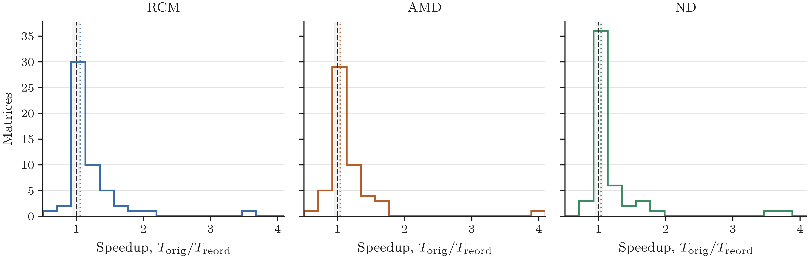
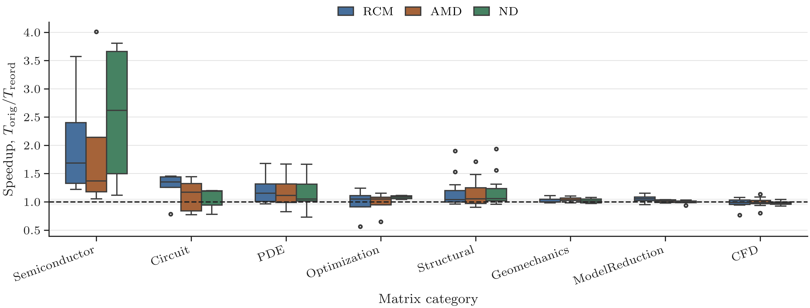
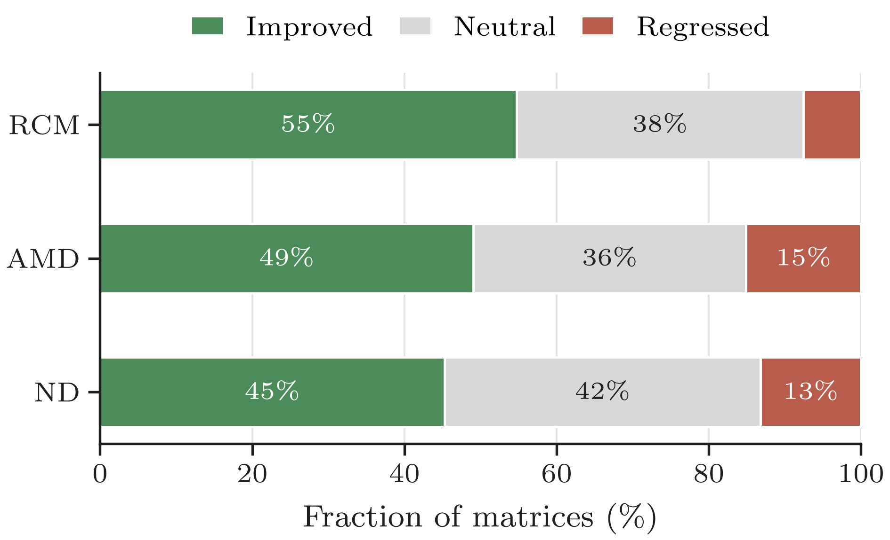
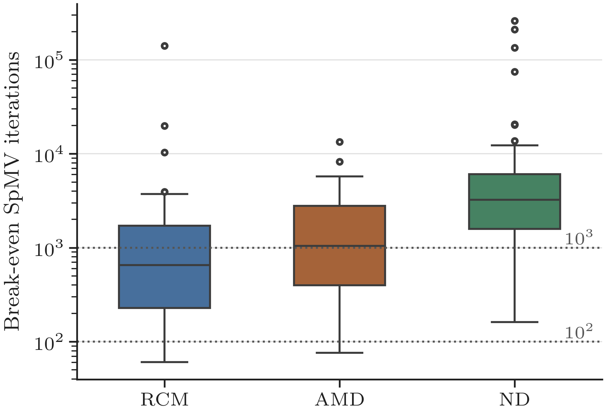
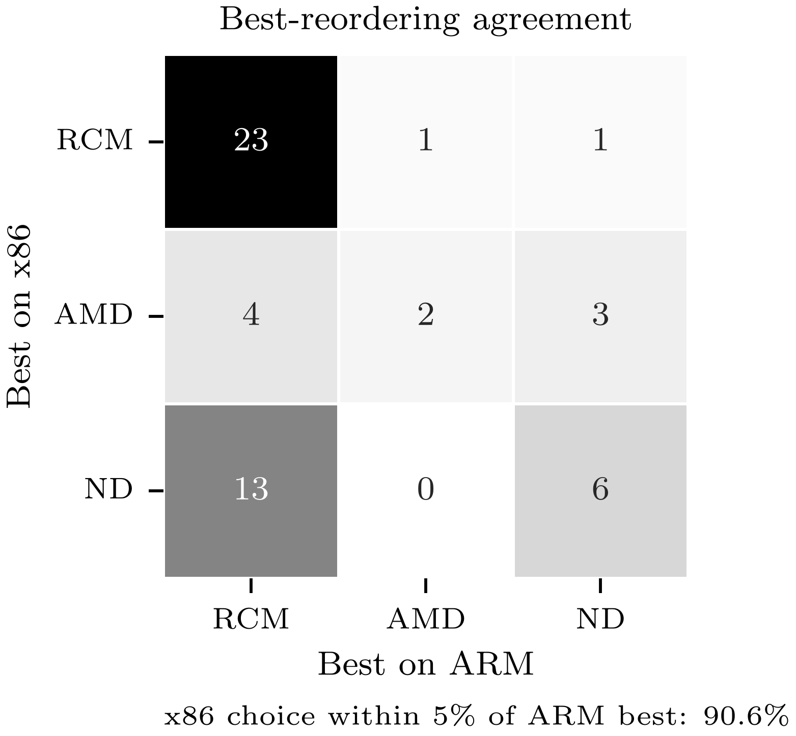
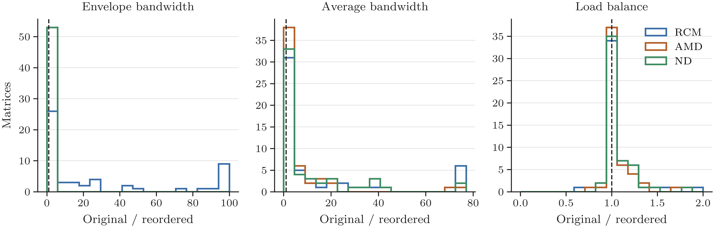
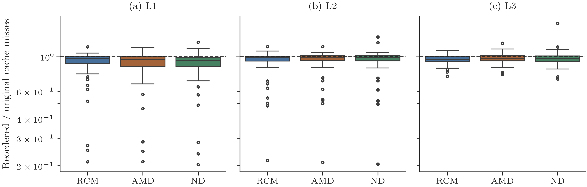
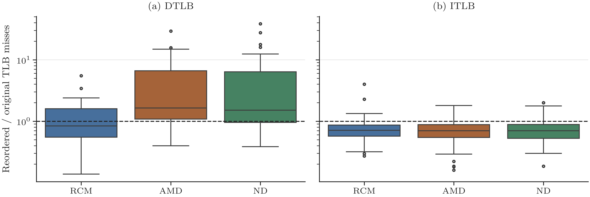

# Result Figures

The default analysis output is a compact thesis figure set. Histograms are kept
only where they add a direct distributional view.

## Speedup by Category

```text
figures/thesis/category_speedup_distribution_<platform>.pdf
figures/thesis/outcome_fraction_bars_<platform>.pdf
figures/distributions/speedup_histogram_<platform>.pdf
```



The speedup histogram shows the full distribution of matrix-level speedups using
real binned counts. The shaded band marks the \( \pm5\% \) neutral region around
the original ordering.



This boxplot is the main performance figure. It shows which matrix families
benefit from reordering and which remain neutral or degrade.



The fraction plot uses the same \( \pm5\% \) neutral band as the aggregate
tables, but presents the result as improved, neutral, and regressed matrix
fractions. Use it when the text needs to state how often each reordering helps.

## Preprocessing Cost

```text
figures/thesis/preprocessing_breakeven_boxplot_<platform>.pdf
```



This replaces the previous histogram. The log-scale boxplot is easier to compare
across reordering methods and directly answers how many SpMV iterations are
needed to amortize preprocessing.

## x86 vs ARM Agreement

```text
figures/thesis/best_reordering_agreement.pdf
```



This is the central cross-architecture figure. The heatmap shows whether the
same reordering is selected as best on both platforms.

## Structural Compression

```text
figures/distributions/structural_compression_histogram_x86.pdf
```



This histogram is kept as the structural companion to the performance results.
It shows how much each reordering compresses envelope bandwidth, average
bandwidth, and load-balance variation.

## Memory-System Mechanism

```text
figures/thesis/cache_miss_ratio_summary_<platform>.pdf
```



This is the direct cache evidence. It summarizes reordered/original cache-miss
ratios by method, so values below 1 mean that the reordering reduced misses. x86
reports L1, L2, and L3; ARM reports the cache levels available in its benchmark
CSV.

## TLB Tradeoff

```text
figures/thesis/tlb_ratio_summary_<platform>.pdf
```



The TLB boxplots show whether reordering reduces or increases address-translation
pressure. This explains cases where locality improvements do not translate cleanly
into speedup.

## Tables

The default table output includes the benchmark matrix set and aggregate
reordering outcomes:

```text
figures/tables/matrix_characteristics.tex
figures/tables/thesis_aggregate_table_x86.tex
figures/tables/thesis_aggregate_table_ARM.tex
```

The matrix-characteristics table is useful in the experimental setup or appendix
because it documents every matrix used in the benchmark. More detailed
per-matrix performance tables can still be generated by the table utilities, but
they are better suited to an appendix than the main text.
